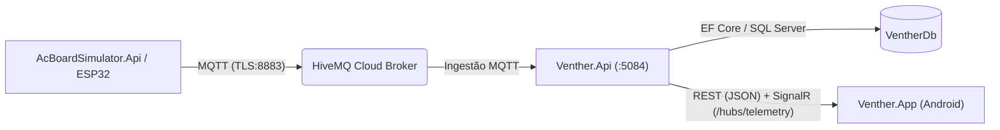

# 📱 Venther.App — Aplicativo Mobile do Técnico de Climatização (HVAC)

[](https://dotnet.microsoft.com/apps/maui)
[-3DDC84?logo=android&logoColor=white)](https://developer.android.com/)
[](https://dotnet.microsoft.com/apps/aspnet/signalr)
[]()

O **Venther.App** é o aplicativo móvel oficial do ecossistema **Venther**, desenvolvido em **.NET MAUI (C# / XAML)** para dispositivos Android. Foi projetado especificamente para técnicos e engenheiros de refrigeração e climatização (HVAC) em campo, permitindo o comissionamento de placas IoT, monitoramento contínuo de grandezas térmicas/mecânicas, recebimento instantâneo de alertas críticos e atendimento a ordens de serviço.

---

## 📑 Sumário

- [1. Visão Geral e Propósito](#1-visão-geral-e-propósito)
- [2. Arquitetura e Stack Tecnológica](#2-arquitetura-e-stack-tecnológica)
- [3. Estrutura de Pastas do Projeto](#3-estrutura-de-pastas-do-projeto)
- [4. Pré-requisitos e Serviços Dependentes](#4-pré-requisitos-e-serviços-dependentes)
- [5. Guia Passo a Passo: Rodar e Testar (USB e Emulador)](#5-guia-passo-a-passo-rodar-e-testar-usb-e-emulador)
- [6. Principais Funcionalidades e Fluxos](#6-principais-funcionalidades-e-fluxos)
- [7. Mapa de Integração (REST e SignalR)](#7-mapa-de-integração-rest-e-signalr)
- [8. Troubleshooting (Resolução de Problemas Comuns)](#8-troubleshooting-resolução-de-problemas-comuns)

---

## 1. Visão Geral e Propósito

### O Desafio
Em sistemas comerciais e industriais de climatização, vazamentos de gás refrigerante, falhas de ventilação, congelamento de serpentinas e entupimentos de filtros geram alto consumo energético, paradas não programadas e custos severos de manutenção. Muitas vezes os técnicos só descobrem os problemas após a parada total dos equipamentos.

### A Solução Venther
O **Venther.App** conecta o técnico diretamente à inteligência preditiva do ecossistema:
1. **Placas IoT (ESP32)** ou o **Simulador de Bancada (`AcBoardSimulator.Api`)** coletam dados de sensores analógicos/digitais a cada 1-3 segundos e publicam via **MQTT** no broker em nuvem HiveMQ.
2. A **`Venther.Api`** ingere os dados, analisa anomalias críticas (ex: vazamento de gás `GAS_LEAK`, sobreaquecimento, obstruções de ar), salva no **SQL Server** e despacha eventos em tempo real.
3. O **`Venther.App`** consome esses dados ao vivo via **WebSockets / SignalR**, notificando o técnico imediatamente, mantendo o equipamento marcado como **Ponto de Atenção / Crítico** e permitindo abrir chamados de manutenção preventiva e corretiva diretamente do celular.



---

## 2. Arquitetura e Stack Tecnológica

O aplicativo adota o padrão **MVVM (Model-View-ViewModel)** estrito, com injeção de dependência nativa do .NET MAUI, desacoplamento por interfaces e compilação de XAML em código C# nativo (`SourceGen`).

### Destaques Arquiteturais
- **MVVM Reativo:** Utiliza o `CommunityToolkit.Mvvm` com geradores de código fonte (`[ObservableProperty]`, `[RelayCommand]`), garantindo sincronização de UI fluida e zero overhead de reflexão.
- **Transmissão em Tempo Real:** Conexão persistente com reconexão automática ao hub SignalR `/hubs/telemetry`, com repasse assíncrono para a `MainThread`.
- **Autenticação e Interceptação HTTP:** `AuthHeaderHandler` (`DelegatingHandler`) injeta o token JWT `Bearer` automaticamente em todas as requisições HTTP realizadas pelo `IApiClient`.
- **Navegação Declarativa Shell:** Navegação centralizada via rotas URI com suporte a desempilhamento automático de abas e controle de retorno físico do Android (`OnBackButtonPressed`).

### Dependências e Versões NuGet (`Venther.App.csproj`)

| Pacote NuGet | Versão | Responsabilidade |
| :--- | :--- | :--- |
| **`Microsoft.Maui.Core`** | `10.0.20` | Core do framework .NET MAUI |
| **`Microsoft.Maui.Controls`** | `$(MauiVersion)` | Componentes visuais, layouts e páginas multiplataforma |
| **`CommunityToolkit.Mvvm`** | `8.4.2` | Infraestrutura MVVM: `ObservableObject`, `RelayCommand`, injeção de atributos |
| **`CommunityToolkit.Maui`** | `10.0.0` | Modais customizados, popups, comportamentos e animações nativas |
| **`Microsoft.AspNetCore.SignalR.Client`**| `11.0.0` | Cliente WebSocket/SignalR para telemetria e falhas em tempo real |
| **`Plugin.LocalNotification`** | `14.2.0` | Notificações push/locais para falhas e chamados no Android |
| **`Microsoft.Extensions.Http`** | `10.0.0` | `IHttpClientFactory` e encadeamento de `HttpMessageHandler` |
| **`Microsoft.Extensions.Logging.Debug`** | `10.0.0` | Logs estruturados no console de depuração |
| **`Microsoft.Extensions.Configuration.UserSecrets`** | `6.0.1` | Suporte a segredos locais em tempo de desenvolvimento |

---

## 3. Estrutura de Pastas do Projeto

```text
Venther.App/
├── App.xaml / App.xaml.cs          # Ponto de entrada XAML e aplicação de estilos globais
├── AppShell.xaml / AppShell.xaml.cs # TabBar (Início, Alertas, Chamados), registro de rotas e back button
├── MauiProgram.cs                  # Composição do container DI, HTTP Clients, handlers e plugins
├── Controls/                       # Componentes de UI reutilizáveis
│   ├── AlertCard.xaml (.cs)        # Card de alerta com badge dinâmico de severidade
│   ├── AppHeader.xaml (.cs)        # Cabeçalho unificado com título, perfil, voltar e sync
│   ├── DeviceCard.xaml (.cs)       # Card de equipamento com barra lateral de status reativa
│   ├── MetricCard.xaml (.cs)       # Card com ícone e leitura dos 4 sensores principais
│   ├── SegmentedControl.xaml (.cs) # Barra segmentada de filtros (Total / Atenção / Normal)
│   ├── StatusBadge.xaml (.cs)      # Badge colorido de status operacional
│   └── StepProgress.xaml (.cs)     # Indicador de etapas no fluxo de comissionamento
├── Converters/                     # Value Converters para formatação de dados em XAML
├── Helpers/                        # Constantes, rotas e utilitários
│   ├── ApiConfig.cs                # Gerenciador de URL base da API (Preferences e padrão)
│   ├── Routes.cs                   # Catálogo de constantes de rotas do AppShell
│   └── TrendChartDrawable.cs       # Renderizador gráfico vetorial (GraphicsView) para histórico
├── Models/                         # Modelos de domínio locais da aplicação
│   ├── AlertItem.cs                # Modelo de alerta exibido na lista e cards
│   ├── Device.cs                   # Equipamento observável (partial class com ObservableProperty)
│   ├── Enums.cs                    # Enumerações (DeviceStatus, AlertSeverity, TrendPeriod)
│   └── WorkOrder.cs                # Ordem de serviço / chamado técnico
├── Platforms/                      # Configurações específicas de plataforma
│   └── Android/
│       ├── AndroidManifest.xml     # Permissões (Internet, Notificações) e usesCleartextTraffic
│       └── Resources/xml/          # network_security_config.xml para HTTP local
├── Resources/                      # Fontes (Inter, OpenSans), Ícones SVG, Splash Screen e Estilos
├── Services/                       # Camada de serviços de negócio e integração
│   ├── AlertService.cs             # Consumo e cache de falhas ativas (/failures)
│   ├── AppNotificationService.cs   # Disparo de notificações locais no sistema Android
│   ├── AuthService.cs              # Login de técnicos (JWT) e validação de credenciais
│   ├── ClientService.cs            # Consulta de clientes e locais vinculados
│   ├── DeviceService.cs            # Consulta (/boards), cadastro e busca de logs históricos
│   ├── DialogService.cs            # Infraestrutura de popups e alertas customizados
│   ├── SessionService.cs           # Armazenamento seguro de token JWT no SecureStorage
│   ├── SyncService.cs              # Fila offline e sincronização em segundo plano
│   ├── TelemetryHubService.cs      # Conexão SignalR (/hubs/telemetry), assinatura e buffers
│   ├── WorkOrderService.cs         # Consulta e conclusão de chamados técnicos
│   ├── Api/                        # Infraestrutura HTTP pura
│   │   ├── ApiClient.cs            # Cliente HTTP genérico com tratamento tipado de erros
│   │   ├── AuthHeaderHandler.cs    # DelegatingHandler que injeta Authorization: Bearer {token}
│   │   └── Dtos/ApiDtos.cs         # DTOs de entrada e saída alinhados com a Venther.Api
│   ├── Interfaces/                 # Contratos para injeção de dependência e desacoplamento
│   └── Mocks/                      # Serviços simulados (comissionamento de hardware)
├── ViewModels/                     # Lógica de apresentação desacoplada da UI
│   ├── AlertsViewModel.cs          # Gerenciamento da aba de Alertas e filtros por severidade
│   ├── DeviceDetailViewModel.cs    # Telemetria ao vivo, fallback para histórico e dados da placa
│   ├── HomeViewModel.cs            # Lista de equipamentos, contadores e busca com debounce
│   ├── WorkOrdersViewModel.cs      # Listagem e filtragem de chamados técnicos
│   └── Auth/                       # ViewModels de Login e Recuperação de Senha
└── Views/                          # Telas XAML organizadas por contexto de negócio
    ├── Alerts/AlertsPage.xaml      # Tela de alertas com segmentação
    ├── Auth/                       # Telas de login, esqueci a senha e redefinição
    ├── Devices/                    # Detalhes do equipamento e etapas de cadastro/ativação
    ├── Home/HomePage.xaml          # Tela inicial com busca fixa e cards de equipamentos
    └── WorkOrders/                 # Listagem e detalhes de chamados técnicos
```

---

## 4. Pré-requisitos e Serviços Dependentes

### Ambiente de Desenvolvimento
- **.NET 10.0 SDK** instalado na máquina de desenvolvimento.
- **Workload .NET MAUI Android:**
  ```powershell
  dotnet workload install maui-android
  ```
- **Android SDK & Platform-Tools (ADB):** Deve estar configurado nas variáveis de ambiente (`PATH` contendo `platform-tools`).
- **Visual Studio 2022 (v17.12+)**, **Visual Studio 2026** ou **VS Code** com as extensões C# Dev Kit e .NET MAUI.

### Serviços que Devem Estar em Execução Antes de Abrir o App
Para testar o fluxo com dados reais (sem mocks de telemetria):

1. **Banco de Dados SQL Server:**
   - Instância ativa com o banco `VentherDb` e migrações aplicadas (`dotnet ef database update`).
2. **`Venther.Api`:**
   - Rodando em `http://0.0.0.0:5084` (ou escutando todas as interfaces locais).
   - Conectada ao broker MQTT HiveMQ Cloud para processar mensagens.
3. **`AcBoardSimulator.Api`:**
   - Rodando e simulando envio contínuo de pacotes MQTT para placas cadastradas no tópico `telemetria/venther/{boardId}`.

---

## 5. Guia Passo a Passo: Rodar e Testar (USB e Emulador)

O teste com **celular físico conectado no cabo USB** é o cenário mais confiável e recomendado.

### 5.1. Configuração da URL Base da API (`ApiConfig.cs`)

O arquivo [Helpers/ApiConfig.cs](file:///C:/Users/49207297825/Source/repos/Venther.App/Helpers/ApiConfig.cs) define onde o app procurará a API:

```csharp
#if DEBUG
    private const string DefaultBaseUrl = "http://localhost:5084"; // Para Celular via USB (com adb reverse)
    // private const string DefaultBaseUrl = "http://10.0.2.2:5084";  // Para Emulador Android Oficial
    // private const string DefaultBaseUrl = "http://SEU_IP_LOCAL:5084"; // Para Wi-Fi na mesma rede
#endif
```

> [!TIP]
> Deixando `http://localhost:5084`, você utiliza o túnel do ADB. Dessa forma, seu celular físico enxerga o computador como `localhost` sem depender de firewall ou oscilações de IP na rede Wi-Fi!

### 5.2. Habilitação de Tráfego HTTP Claro (`AndroidManifest.xml`)
No Android 9 (API 28) ou superior, conexões HTTP puro são bloqueadas por padrão. O projeto já está configurado em [Platforms/Android/AndroidManifest.xml](file:///C:/Users/49207297825/Source/repos/Venther.App/Platforms/Android/AndroidManifest.xml) com:
```xml
<application ... android:usesCleartextTraffic="true" ...>
```

### 5.3. Criando o Túnel USB com ADB (Celular Físico)

1. Conecte o celular via cabo USB e habilite a **Depuração USB** nas opções de desenvolvedor.
2. No terminal do Windows, confira se o dispositivo é reconhecido:
   ```powershell
   adb devices
   ```
   *(Deve listar o identificador do aparelho com status `device`).*
3. Crie o túnel reverso da porta 5084:
   ```powershell
   adb reverse tcp:5084 tcp:5084
   ```
4. **Teste no celular:** Abra o Chrome do próprio celular e acesse `http://localhost:5084/swagger`. Se a página abrir, a ponte de rede está 100% pronta!

### 5.4. Compilação e Execução via CLI

Execute os comandos na raiz do repositório:

```powershell
# 1. Restaurar dependências
dotnet restore Venther.App\Venther.App.csproj

# 2. Compilar especificando o target Android
dotnet build Venther.App\Venther.App.csproj -f net10.0-android -r android-arm64

# 3. Executar e instalar diretamente no celular conectado
dotnet run --project Venther.App\Venther.App.csproj -f net10.0-android
```

---

## 6. Principais Funcionalidades e Fluxos

### 🔐 1. Autenticação e Perfil de Técnico
- Login via e-mail e senha consumindo `POST /api/auth/login`.
- O aplicativo valida se o usuário possui a role **`Technician`**.
- O token JWT é armazenado de forma criptografada via `Microsoft.Maui.Storage.SecureStorage`.
- Suporte a recuperação de senha com envio de código e redefinição segura.

### 📊 2. Monitoramento em Tempo Real (Home)
- **Status Operacional Reativo:**
  - `Normal` (Verde): Equipamento operando dentro das especificações e online.
  - `Ponto de Atenção` (Laranja): Equipamento desconectado ou com variações anormais.
  - `Crítico` (Vermelho): Equipamento com falha ativa (ex: vazamento de gás).
- **Preservação de Estado:** Ao receber pacotes MQTT rotineiros a cada segundo, o app **não rebaixa** um equipamento crítico para normal enquanto a falha não for resolvida.
- **Busca com Debounce:** A caixa de pesquisa na Home possui delay de 300ms, permitindo digitação contínua sem travamentos e sem perda de foco do teclado virtual.

### ❄️ 3. Detalhes do Equipamento e Leituras de Sensores
Ao tocar em qualquer card de equipamento ou alerta, abre-se a `DeviceDetailPage`:
- **4 Grandezas Fundamentais:**
  - **Temp. Insuflamento:** Temperatura do ar insuflado no ambiente (°C).
  - **Temp. Retorno:** Temperatura do ar retornado para a máquina (°C).
  - **Linha de Gás:** Temperatura (°C) ou pressão de sucção (PSI) do fluído refrigerante (ex: R410A).
  - **Delta P Evaporador:** Queda de pressão na serpentina (Pa) para detecção de filtro sujo ou congelamento.
- **Gráfico de Tendência:** Renderização via `GraphicsView` com histórico de 1h, 12h e 24h.
- **Fallback Inteligente:** Caso não haja leitura do SignalR naquele exato segundo, a tela realiza fallback automático para os últimos registros históricos em `/api/boards/{id}/logs`.

### 🚨 4. Gestão de Alertas e Ordens de Serviço
- Alertas gerados automaticamente na `Venther.Api` a partir de regras preditivas de telemetria.
- Notificações push locais disparadas diretamente no celular do técnico através do evento `FaultRaised`.
- Abertura da lista de chamados (`WorkOrdersPage`) com opção de marcar como concluído (`CompleteMaintenanceRequest`).

### 🛠️ 5. Comissionamento de Placas
- Fluxo de adição de nova máquina guiado pelo `StepProgress` (Leitura de MAC -> Cadastro de Cliente/Local -> Pareamento).
- O cadastro de placa é persistido de verdade na API (`POST /api/boards`), enquanto a etapa de Wi-Fi utiliza o serviço de mock local para homologação.

---

## 7. Mapa de Integração (REST e SignalR)

### Endpoints REST (`Venther.Api`)

| Método | Endpoint | ViewModel / Serviço | Descrição |
| :--- | :--- | :--- | :--- |
| `POST` | `/api/auth/login` | `AuthService` | Autenticação do técnico e obtenção do JWT |
| `POST` | `/api/auth/forgot-password`| `ForgotPasswordViewModel`| Solicitação de código de recuperação |
| `POST` | `/api/auth/reset-password` | `ResetPasswordViewModel` | Redefinição de senha com token |
| `GET` | `/api/boards` | `DeviceService` / `HomeViewModel` | Listagem paginada de placas cadastradas |
| `GET` | `/api/boards/{id}` | `DeviceDetailViewModel` | Consulta de detalhes cadastrais da placa |
| `POST` | `/api/boards` | `RegisterDeviceViewModel` | Cadastro de nova placa no sistema |
| `GET` | `/api/boards/{id}/logs` | `DeviceDetailViewModel` | Histórico mensal de logs de telemetria |
| `GET` | `/api/failures` | `AlertService` / `AlertsViewModel` | Listagem de falhas/alertas ativos |
| `GET` | `/api/maintence_requests` | `WorkOrderService` | Listagem de ordens de serviço |
| `PUT` | `/api/maintence_requests/{id}` | `WorkOrderService` | Conclusão de uma ordem de serviço |

### Hub SignalR (`/hubs/telemetry`)

| Tipo | Nome | Direção | Payload / Parâmetros | Descrição |
| :--- | :--- | :--- | :--- | :--- |
| **Invocação** | `SubscribeToBoards` | App -> Hub | `Guid[] boardIds` | Assina as placas visíveis e retorna o snapshot atual |
| **Invocação** | `UnsubscribeFromBoards`| App -> Hub | `Guid[] boardIds` | Cancela a assinatura ao sair da tela de detalhes |
| **Evento** | `TelemetryUpdated` | Hub -> App | `BoardTelemetryDto` | Leitura de sensores transmitida em tempo real |
| **Evento** | `FaultRaised` | Hub -> App | `FaultRaisedDto` | Notificação imediata de nova anomalia crítica |

---

## 8. Troubleshooting (Resolução de Problemas Comuns)

### 1. Erro ao Fazer Login: "Falha ao conectar no servidor"
- **Causa:** O celular físico não está conseguindo alcançar a API em `localhost:5084`.
- **Solução:**
  1. Conecte o cabo USB e execute no terminal do Windows:
     ```powershell
     adb reverse tcp:5084 tcp:5084
     ```
  2. Verifique se a `Venther.Api` está rodando e escutando na porta `5084`.
  3. No navegador do celular, abra `http://localhost:5084/swagger`.

### 2. SignalR Desafiado: "Bearer was challenged"
- **Causa:** O token JWT não estava sendo injetado na negociação WebSocket.
- **Solução:** O `TelemetryHubService` já está configurado com:
  ```csharp
  options.AccessTokenProvider = () => Task.FromResult(_sessionService.Token);
  ```
  Na API, o `Program.cs` escuta `context.Request.Query["access_token"]` para rotas que iniciam com `/hubs/telemetry`. Certifique-se de que a API está atualizada.

### 3. Tela de Detalhes abre com valores "--"
- **Causa:** A placa selecionada ainda não recebeu telemetria do simulador ou o SignalR está conectando.
- **Solução:** O app possui fallback automático para `/api/boards/{id}/logs`. Verifique se o `AcBoardSimulator.Api` está rodando e publicando dados para o `Guid` da placa em questão.

### 4. Como Provocar Falhas para Testar o Alerta e o Status "Crítico"
Para forçar um alarme ao vivo no celular sem esperar uma anomalia natural, envie uma requisição HTTP para a API do simulador:

```bash
# Simular Vazamento Crítico de Gás (GAS_LEAK)
curl -X POST http://localhost:5242/api/simulator/{BOARD_ID}/preset/GAS_LEAK

# Simular Filtro de Ar Obstruído (AIR_FILTER_DIRTY)
curl -X POST http://localhost:5242/api/simulator/{BOARD_ID}/preset/AIR_FILTER_DIRTY

# Voltar ao modo normal
curl -X POST http://localhost:5242/api/simulator/{BOARD_ID}/preset/NORMAL
```

Ao disparar o comando:
1. O simulador publicará as temperaturas anômalas via MQTT.
2. A `Venther.Api` detectará o limite excedido e criará a `Failure` e a `MaintenanceRequest`.
3. O evento `FaultRaised` chegará ao `Venther.App`, gerando a notificação no Android e marcando o equipamento como **Crítico / Ponto de Atenção** instantaneamente.

---

**Equipe Venther Climatização** • *Documentação técnica gerada para onboarding e manutenção contínua.*


Localize o adb.exe no PowerShell e verifique se o celular foi reconhecido Com o celular conectado no cabo USB e a Depuração USB ativada nas Opções do Desenvolvedor do Android, cole e execute o comando abaixo no PowerShell para buscar o adb.exe automaticamente e listar o aparelho:

PowerShell $adb = Get-ChildItem -Path "C:\Program Files (x86)\Android", "$env:LOCALAPPDATA\Android", "C:\Android" -Filter "adb.exe" -Recurse -ErrorAction SilentlyContinue | Select-Object -First 1 -ExpandProperty FullName Write-Host "ADB encontrado em: $adb" & $adb devices Verificação: O terminal mostra o caminho do adb.exe e, abaixo de List of devices attached, aparece o código do seu celular seguido de device (se aparecer unauthorized, olhe a tela do celular e toque em Permitir).

Crie o túnel da porta 5084 para o celular Na mesma janela do PowerShell (para aproveitar a variável $adb), execute:

PowerShell & $adb reverse tcp:5084 tcp:5084 Verificação: O PowerShell retorna apenas 5084 sem mensagens de erro.

Teste o Swagger no navegador do celular Com a Venther.Api rodando no PC (dotnet run), abra o Google Chrome no celular e acesse http://localhost:5084/swagger. Verificação: A interface do Swagger da API carrega normalmente na tela do celular. | PUT /api/maintence_requests/{id} | WorkOrderService | Integrado | | GET /api/failures | AlertService | Integrado | | WS /hubs/telemetry | TelemetryHubService | Integrado | | Provisionamento Wi-Fi ESP32 | MockDeviceProvisioningService | Mock (conforme contrato) |

| Endpoint / Canal | Serviço | Status |
| :--- | :--- | :--- |
| `POST /api/auth/login` | `AuthService` | Integrado |
| `POST /api/auth/logout` | `AuthService` | Integrado |
| `POST /api/auth/forgot-password` | `AuthService` | Integrado |
| `POST /api/auth/reset-password` | `AuthService` | Integrado |
| `GET /api/boards` | `DeviceService` | Integrado |
| `GET /api/boards/{id}` | `DeviceService` | Integrado |
| `POST /api/boards` | `DeviceService` | Integrado |
| `GET /api/boards/{id}/logs` | `DeviceService` | Integrado |
| `GET /api/customers` | `ClientService` | Integrado |
| `GET /api/customers/{id}` | `ClientService` | Integrado |
| `GET /api/maintence_requests` | `WorkOrderService` | Integrado |
| `GET /api/maintence_requests/{id}` | `WorkOrderService` | Integrado |

Localize o adb.exe no PowerShell e verifique se o celular foi reconhecido
Com o celular conectado no cabo USB e a Depuração USB ativada nas Opções do Desenvolvedor do Android, cole e execute o comando abaixo no PowerShell para buscar o adb.exe automaticamente e listar o aparelho:

PowerShell
$adb = Get-ChildItem -Path "C:\Program Files (x86)\Android", "$env:LOCALAPPDATA\Android", "C:\Android" -Filter "adb.exe" -Recurse -ErrorAction SilentlyContinue | Select-Object -First 1 -ExpandProperty FullName
Write-Host "ADB encontrado em: $adb"
& $adb devices
Verificação: O terminal mostra o caminho do adb.exe e, abaixo de List of devices attached, aparece o código do seu celular seguido de device (se aparecer unauthorized, olhe a tela do celular e toque em Permitir).

Crie o túnel da porta 5084 para o celular
Na mesma janela do PowerShell (para aproveitar a variável $adb), execute:

PowerShell
& $adb reverse tcp:5084 tcp:5084
Verificação: O PowerShell retorna apenas 5084 sem mensagens de erro.

Teste o Swagger no navegador do celular
Com a Venther.Api rodando no PC (dotnet run), abra o Google Chrome no celular e acesse http://localhost:5084/swagger.
Verificação: A interface do Swagger da API carrega normalmente na tela do celular.
| `PUT /api/maintence_requests/{id}` | `WorkOrderService` | Integrado |
| `GET /api/failures` | `AlertService` | Integrado |
| `WS /hubs/telemetry` | `TelemetryHubService` | Integrado |
| Provisionamento Wi-Fi ESP32 | `MockDeviceProvisioningService` | Mock (conforme contrato) |
